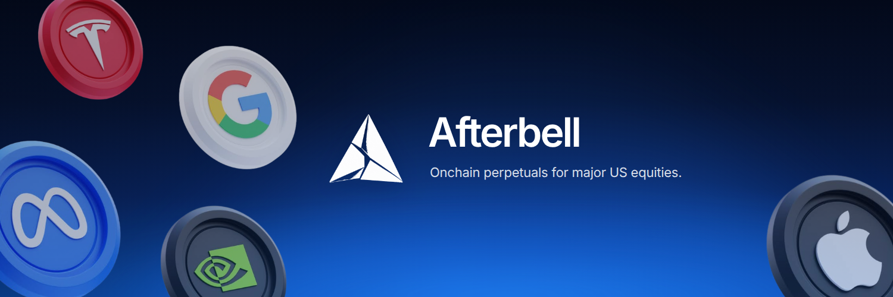
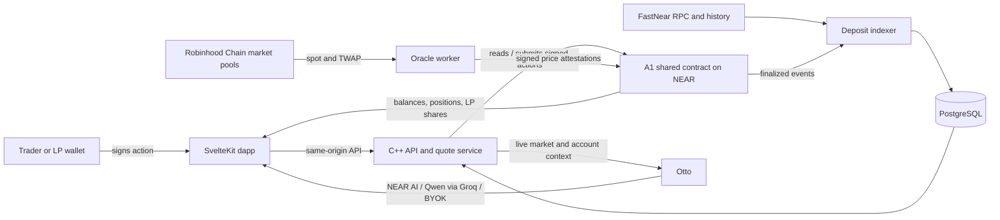
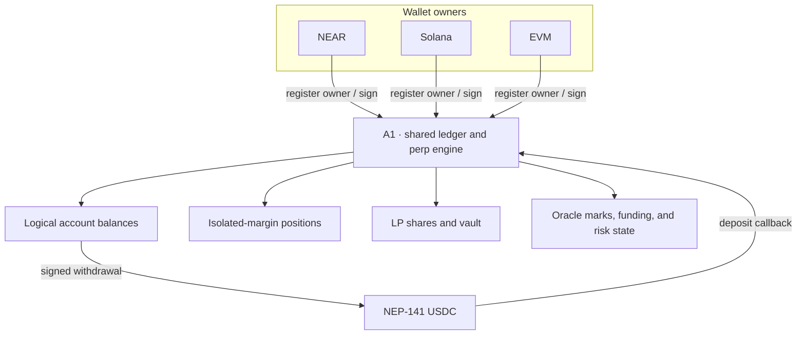

# Afterbell

[](https://github.com/DavidNzube101/afterbell/actions/workflows/ci.yml)


Afterbell is an on-chain perpetual trading system for synthetic US equity markets. Traders, liquidity providers, market data services, and AI assistance meet through one shared account and a single NEAR contract.

## Thesis

On-chain trading should feel like one coherent product: connect a wallet once, hold one USDC balance, trade across markets, and provide liquidity through the same account. A shared contract keeps settlement and account state composable, while fast off-chain services handle quotes, market data, indexing, and AI context. Wallet signatures authorize actions; A1 verifies and settles them on NEAR.

This build began on Nov 2, 2026, during the opening days of NEAR HACKATHON.

## Product links

| | Link |
|---|---|
| Dapp | [afterbellfx.xyz](https://afterbellfx.xyz) |
| Website | [testnet.afterbellfx.xyz](https://testnet.afterbellfx.xyz) |
| Docs | [docs.afterbellfx.xyz](https://docs.afterbellfx.xyz) |
| X | [@afterbellfx](https://x.com/afterbellfx) |
| Source | [github.com/DavidNzube101/afterbell](https://github.com/DavidNzube101/afterbell) |

### Deployments and addresses

| Network / component | Address or integration | Explorer |
|---|---|---|
| NEAR Testnet · A1 shared contract | `afterbellfx-dev-faucet.testnet` | [NEARBlocks](https://testnet.nearblocks.io/address/afterbellfx-dev-faucet.testnet) |
| NEAR Testnet · USDC | `3e2210e1184b45b64c8a434c0a7e7b23cc04ea7eb7a6c3c32520d03d4afcb8af` | [NEARBlocks](https://testnet.nearblocks.io/address/3e2210e1184b45b64c8a434c0a7e7b23cc04ea7eb7a6c3c32520d03d4afcb8af) |
| NEAR Mainnet · 1Click deposits | Mainnet deposit integration through NEAR Intents; separate from the testnet A1 trading deployment | [NEAR Intents](https://near-intents.org/) |
| NEAR Mainnet · USDC | `17208628f84f5d6ad33f0da3bbbeb27ffcb398eac501a31bd6ad2011e36133a1` | [NEARBlocks](https://nearblocks.io/address/17208628f84f5d6ad33f0da3bbbeb27ffcb398eac501a31bd6ad2011e36133a1) |

A1 is deployed on NEAR Testnet. The mainnet milestone is the separate 1Click deposit integration. The machine-readable A1 deployment record is [`contracts/deployments.yaml`](contracts/deployments.yaml).

## How the system works



The browser handles wallet connection, user experience, and wallet signatures. The C++ API builds quotes, relays signed actions, serves snapshots and history, and assembles Otto's live context. A dedicated worker reads Robinhood Chain pools and publishes signed market prices to A1. The indexer uses FastNear to discover finalized A1 deposit activity and stores it in PostgreSQL for fast account history and notifications; A1 remains authoritative for balances and settlement.

## A1 shared contract

A1 is Afterbell's current shared-contract system: one NEAR deployment serves logical accounts across NEAR, Solana, and EVM wallets. Users keep one USDC balance for trading and liquidity; positions use isolated margin, while LP shares represent a claim on the shared vault. A1 verifies owner and quote signatures and performs accounting and settlement on-chain.



The active app deployment is **A1** (`afterbellfx-dev-faucet.testnet`). Earlier factory and per-user-account prototypes are not part of the current system.

## Core features

- **Trading:** open long and short positions, manage isolated margin, reduce or close positions, and place or cancel standing limit orders. Quotes bind the owner signature to the market mark and sequence; A1 verifies authorization and settles the action.
- **Liquidity:** deposit USDC into the shared vault, receive LP shares, view vault/account metrics, and withdraw by redeeming shares.
- **Otto:** ask about live prices, positions, and account context. Otto supports NEAR AI with privacy filtering and TEE-backed inference, Qwen through Groq as the platform default/fallback, and OpenAI-compatible BYOK providers. Platform credentials stay on the backend; BYOK keys are request-scoped.
- **Markets:** follow AAPL, GOOGL, META, NVDA, and TSLA prices, history, and volume. The oracle reads Robinhood Chain stock/USDG pools and publishes signed marks to A1 on NEAR.
- **Deposits:** use NEAR USDC for A1 testnet deposits and the separate 1Click integration for NEAR mainnet deposits.

NEAR AI platform-credit payment: [view transaction on NEAR Intents Explorer](https://explorer.near-intents.org/transactions/24502f58e8485a30c7be6e079f74b8a341fef610cbdeb031a785c5e88a2c37b2).

## Run locally

Requirements: Bun 1.4+, CMake, a C++17 compiler, PostgreSQL, and the backend libraries. On macOS:

```sh
brew install cmake pkg-config postgresql@17 curl jsoncpp drogon openssl@3
```

1. Configure the backend from [`backend/.env.example`](backend/.env.example) into `backend/.env`. Set `DATABASE_URL`, the NEAR network/RPC, A1 contract, and USDC token. Enable trading/oracle workers and provider keys only when needed. Keep private keys and API keys out of Git.
2. Build and start the API from the repository root:

   ```sh
   export CMAKE_PREFIX_PATH="$(brew --prefix postgresql@17):$(brew --prefix curl):$(brew --prefix jsoncpp)"
   make build
   make api
   ```

3. In another terminal, configure [`interface/.env.example`](interface/.env.example) as `interface/.env`, install dependencies, and start the dapp:

   ```sh
   cd interface
   bun install --frozen-lockfile
   bun run dev
   ```

The API listens on port `8080`; the interface defaults its local API proxy to `http://localhost:8080`. Run the C++ indexer tests with `ctest --test-dir backend/build --output-on-failure`. Set `INDEXER_ENABLED=true` to run the indexer with the API, or use `make indexer` to run it separately.

## Environment files

Use one example file per app and copy it to the matching `.env` file. `VITE_` variables are public frontend configuration; never put secrets in the interface environment.

| App | Environment file | Main settings |
|---|---|---|
| Interface | [`interface/.env.example`](interface/.env.example) | `VITE_API_PROXY_TARGET`, `VITE_NEAR_NETWORK`, `VITE_A1_CONTRACT_ID` |
| Backend | [`backend/.env.example`](backend/.env.example) | NEAR RPC/network, A1 and USDC IDs, database, FastNear, oracle/trading switches, NEAR AI/Groq credentials |

## API and documentation

The complete OpenAPI 3.1 specification is [`openapi.yaml`](openapi.yaml). It covers account setup, market data, trading, LP actions, Otto, notifications, and waitlist routes. Product guides and user documentation are at [docs.afterbellfx.xyz](https://docs.afterbellfx.xyz).

